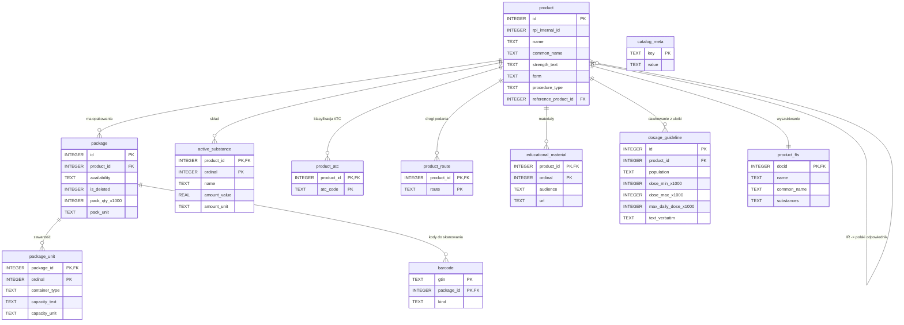
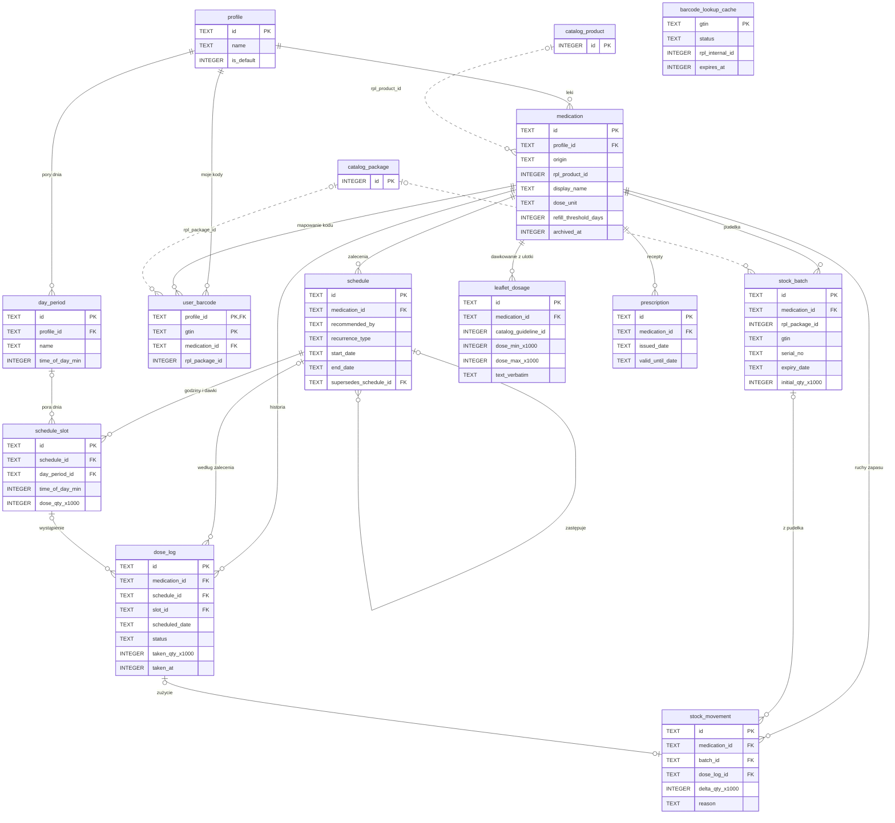

# Model danych medi-tracker

Projekt bazy danych aplikacji (Kotlin, Android, SQLite). 

| Plik | Zawartość |
|---|---|
| [`schema/catalog_db.sql`](schema/catalog_db.sql) | katalog leków z RPL (tylko do odczytu) |
| [`schema/user_db.sql`](schema/user_db.sql) | dane użytkownika (harmonogramy, historia, zapasy, cache) |
| [`schema/queries.sql`](schema/queries.sql) | kluczowe zapytania: skan, wyszukiwanie, agenda dnia, oznaczenie dawki, stan zapasu |

## Najważniejsze decyzje

1. **Przetwarzanie wyłącznie lokalne.** Dane użytkownika nie opuszczają telefonu; jedyną kopią poza urządzeniem jest szyfrowany end-to-end Android Auto Backup. 
2. **SQLite przez Room jako jedyna baza.** Brak własnego backendu.
3. **Dwa pliki bazy:**
   - `catalog.db`: katalog z RPL, tylko do odczytu, podmieniany w całości;
   - `user.db`: dane użytkownika.
   
   Aktualizacja katalogu nigdy nie dotyka danych użytkownika.
4. **Katalog budujemy z eksportu XML RPL i dostarczamy razem z aplikacją.** Nie odpytujemy API przy każdym skanie. Powód jest twardy: API JSON nie zwraca opakowań, więc nie podaje liczby tabletek w pudełku (`rpl.md`, sekcja o API). Bez tego nie działa śledzenie zapasów, jedna z głównych funkcji z karty projektu. Do tego API jest nieudokumentowane, a skan z katalogu działa w 100% offline.
5. **API JSON RPL to tylko fallback** dla kodów, których nie ma w lokalnym katalogu, czyli opakowań nowszych niż snapshot. Odpowiedzi trafiają do cache w `barcode_lookup_cache`.
6. **Zapas jako dziennik ruchów (ledger), a nie licznik.** Stan to `SUM(delta)`, więc każdą zmianę da się wyjaśnić i cofnąć.
7. **Zalecenie lekarza (`schedule`) i dawkowanie z ulotki (`leaflet_dosage`) to osobne byty.** Nigdy nie nadpisujemy jednego drugim.

---

## 1. Architektura

**Komponenty:**
- **Potok katalogu:** GitHub Actions (cron, np. raz w tygodniu) pobiera `overall.xml` z RPL i uruchamia skrypt importu. Opcjonalnie dociąga też CSV z komunikatami bezpieczeństwa oraz PDF-y ChPL i EMA dla `dosage_guideline`. Wynikiem są plik `catalog-RRRR-MM-DD.db.gz` i `manifest.json`, publikowane jako GitHub Release albo na dowolnym statycznym hostingu. Potok przetwarza wyłącznie publiczne dane z RPL, bez danych osobowych.
- **Telefon:**
  - `catalog.db`: początkowo kopiowany z assets APK, później podmieniany przez Worker;
  - `user.db`: Room, tryb WAL;
  - warstwa repozytoriów, z której korzystają UI, powiadomienia i skaner.
  
  Do sieci aplikacja wychodzi tylko w dwóch sytuacjach: po aktualizację katalogu i do API JSON RPL dla kodów spoza katalogu.

### Katalog (`catalog.db`)

- **Budowa.** Skrypt (Python, bo analiza w `rpl.md` już tak powstała) parsuje XML według zakresu z `rpl.md`: `ludzki`, GTIN niepusty.
  - **Wykreślone opakowania zostawiamy** z `is_deleted = 1`, bo użytkownik może mieć w domu stare pudełko.
  - Normalizuje GTIN do 14 cyfr, zamienia `"brak"` i `"-"` na NULL, parsuje liczby z przecinkiem i liczy `pack_qty_x1000` z `jednostkaOpakowania`.
  - Dla IR wylicza `reference_product_id` (klucz: INN + moc bez spacji + postać, trafia w ok. 85% przypadków).
  - Zapisuje `catalog_meta.source_as_of = stanNaDzien`.
- **Rozmiar (szacunek do zmierzenia).** Ok. 19 tys. produktów i 64 tys. opakowań to rząd 10–20 MB bez kompresji i kilka MB w APK. Jeśli to za dużo, URL-e ulotek i ChPL można wyliczać z `rpl_internal_id` zamiast je przechowywać (wzorzec w `rpl.md`).
- **Dostarczenie.** `Room.databaseBuilder(...).createFromAsset("catalog.db")`.
- **Aktualizacja.** `PeriodicWorkRequest` co 7 dni, tylko przez Wi-Fi i gdy bateria nie jest niska:
  1. Pobierz `manifest.json` (`{version, schema_version, url, sha256, bytes}`). Jeśli wersja jest ta sama, zakończ.
  2. Pobierz plik do katalogu tymczasowego. Sprawdź `sha256`, wynik `PRAGMA quick_check` i zgodność `schema_version`.
  3. Zamknij instancję Room katalogu, podmień plik atomowo (`rename`) i otwórz go ponownie.
  4. Wyczyść cache przez `ATTACH`: `DELETE FROM barcode_lookup_cache WHERE status = 'NOT_FOUND' OR gtin IN (SELECT gtin FROM cat.barcode)`. Nowy katalog ma pierwszeństwo przed cache.
- **Licencja CC BY 4.0.** Każdy ekran z danymi RPL pokazuje: „Źródło: RPL, URPL / CeZ, stan na {source_as_of}”. Dla leku użytkownika data jest zapamiętana w `medication.rpl_source_as_of`.

### Dane użytkownika (`user.db`)

- Room w trybie WAL (domyślnym dla Room). Każdy zapis wieloetapowy, np. „przyjęto dawkę” plus „zdejmij z zapasu”, wykonujemy w jednej `@Transaction`.
- **Przypomnienia.** Wystąpień dawek nie zapisujemy z wyprzedzeniem. Raz na dobę Worker wylicza najbliższe 24–48 h zapytaniem Q4 i ustawia alarmy przez `AlarmManager.setExactAndAllowWhileIdle`. To samo dzieje się po `BOOT_COMPLETED`, po zmianie strefy czasowej i po edycji harmonogramu. `requestCode` alarmu jest deterministyczny (hash `slot_id` + data), więc da się go nadpisać lub anulować bez osobnej tabeli.
- **Pominięte dawki.** Gdy okno dawki minie (np. po 2 h), Worker wstawia `dose_log` ze statusem `MISSED` i `source = 'AUTO'`.

---

## 2. Przetwarzanie lokalne a RODO

Dane o przyjmowanych lekach to dane o zdrowiu, czyli szczególna kategoria danych (art. 9 RODO).

RODO nie zabrania trzymania ich w chmurze gdzie podstawą może być wyraźna zgodajednak wtedy autorzy aplikacji stają się administratorem takich danych, co pociąga za sobą dopowiedzialność za nie czego na ten oment lepiej uniknąć.

### Kopia zapasowa: Android Auto Backup

Kopia trafia na Dysk Google użytkownika. Od Androida 9, przy ustawionej blokadzie ekranu, jest szyfrowana po stronie klienta, więc ani my, ani Google nie mamy dostępu do treści. Limit to 25 MB na aplikację, dlatego:
- `catalog.db` wykluczamy: zająłby limit, a aplikacja i tak go odtworzy (`createFromAsset` albo pobranie);
- kopia obejmuje tylko `user.db` z plikiem WAL;
- wyłączamy kopię na urządzeniach, które nie zapewniają szyfrowania.

## 3. Tabele i relacje

Linia ciągła oznacza klucz obcy. Linia przerywana oznacza miękką referencję do drugiego pliku (`catalog.db`); SQLite jej nie wymusza.

### `catalog.db`

### `user.db`

## 4. Skanowanie kodu i cache

### 4.1 Co skanujemy

- **EAN-13 z pudełka.** Dopełniamy zerem do 14 cyfr i sprawdzamy cyfrę kontrolną (mod 10), zanim odpytamy bazę.
- **GS1 DataMatrix (kod 2D).** Leki na receptę w UE mają go od 2019 roku (dyrektywa o sfałszowanych lekach, FMD). Kod zawiera:
  - AI `(01)`: GTIN-14;
  - AI `(17)`: datę ważności;
  - AI `(10)`: numer serii;
  - AI `(21)`: numer seryjny.
  
  ML Kit Barcode Scanning czyta DataMatrix, więc przy dodawaniu pudełka `stock_batch` wypełnia się sam: data ważności, seria i numer seryjny, który chroni przed podwójnym dodaniem. Pola o zmiennej długości rozdziela znak FNC1 / GS (`\u001D`).
- **Wielokrotne odczyty.** Kamera zwraca ten sam kod wiele razy na sekundę. Wynik przyjmujemy dopiero po dwóch identycznych odczytach z rzędu, a równoległe zapytania o ten sam GTIN łączymy w jedno (mapa `gtin → Deferred`).

### 4.2 Kolejność wyszukiwania

1. **Normalizacja i walidacja GTIN.** Kod z błędną cyfrą kontrolną odrzucamy od razu.
2. **`user.user_barcode`** (profil + GTIN). Trafienie oznacza lek, który użytkownik już powiązał z tym kodem, np. suplement. Bez sieci.
3. **`catalog.barcode` złączone z `package` i `product`** (zapytanie Q1). Bez sieci.
   - Jeden wynik: pokazujemy kartę leku.
   - Kilka wyników: użytkownik wybiera, a wybór zapisujemy w `user_barcode`, żeby następnym razem nie pytać.
4. **`user.barcode_lookup_cache`**:
   - ważny wpis FOUND: karta leku z danych w cache; wielkość opakowania wpisuje użytkownik, bo API jej nie podaje;
   - ważny wpis NOT_FOUND: od razu formularz ręczny, bez sieci;
   - przeterminowany wpis FOUND: pokazujemy dane z cache i odświeżamy je w tle (stale-while-revalidate).
5. **API JSON RPL** (`?eanGtin=…&size=5`), tylko gdy kod nie ma ważnego wpisu w cache:
   - online: wynik zapisujemy w cache;
   - offline: wpis dostaje status PENDING, a WorkManager odpyta API, gdy pojawi się sieć. Użytkownik od razu dostaje formularz ręczny. Gdy odpowiedź przyjdzie, aplikacja zaproponuje połączenie wpisu z lekiem z RPL.
6. **Formularz ręczny.** Tworzy `medication` z `origin = MANUAL` i wpis w `user_barcode`.

Kroki 2–3 obsłużą praktycznie każdy skan leku dostępnego w Polsce, w pełni offline. Do sieci trafiają tylko kody spoza snapshotu: opakowania nowsze niż katalog oraz produkty spoza RPL. RPL nie obejmuje suplementów diety ani wyrobów medycznych, a użytkownicy będą je skanować; po pierwszym razie trafią do `user_barcode`.

### 4.3 Zasady cache (`barcode_lookup_cache`)

| Status | Kiedy | Ważność | Co dalej |
|---|---|---|---|
| FOUND | API zwróciło od jednego do kilku produktów | 30 dni, potem odświeżenie w tle | usuwany, gdy nowy katalog zawiera ten GTIN (katalog ma pierwszeństwo) |
| NOT_FOUND | `totalElements = 0` | 7 dni | czyszczony przy każdej aktualizacji katalogu |
| PENDING | brak sieci | do skutku | WorkManager z ograniczeniem `CONNECTED` |
| ERROR | timeout, 5xx albo podejrzana odpowiedź | nie liczy się jako odpowiedź | ponawianie z rosnącym odstępem (1 min … 1 h), maksymalnie N prób |

**Pułapka z `rpl.md`:** API po cichu ignoruje nieznany parametr i wtedy zwraca całą bazę. Odpowiedź, w której `totalElements` przekracza kilka, traktujemy jako ERROR, nigdy jako FOUND.

---

## 5. Sugerowane dawkowanie z ulotki obok zalecenia lekarza

- **Dwie warstwy danych:**
  - `catalog.dosage_guideline`: wytyczne producenta wyciągnięte w potoku katalogu z sekcji 4.2 ChPL, z ulotki albo z EPAR. Dla CEN źródłem jest EMA, dla IR polski odpowiednik (`reference_product_id`, zapytanie Q3).
  - `user.leaflet_dosage`: kopia z katalogu albo wpis użytkownika, którą użytkownik może poprawić.
- **Dane liczbowe razem z dosłownym tekstem.** Pola liczbowe pozwalają czytelnie zestawić „Lekarz: 1 tabl. 2× dziennie” z „Ulotka: 1–2 tabl., maks. 8 tabl./dobę”. Zawsze towarzyszy im `text_verbatim`, bo parser może się pomylić, a `verified` mówi, czy ktoś wynik sprawdził.
- **Ostrożnie z logiką.** `rpl.md` zauważa, że *obliczanie* dawek albo ostrzeganie może podpaść pod MDR (oprogramowanie jako wyrób medyczny). Schemat pozwala w przyszłości porównać `schedule_slot` z `max_daily_dose_x1000`, ale **w v1 rekomenduję tylko wyświetlanie obu wartości obok siebie, bez automatycznych ostrzeżeń.** Włączenie ostrzeżeń to decyzja regulacyjna, nie techniczna.
- **Bez hostowania ulotek.** Przechowujemy link do PDF w RPL lub EMA oraz wyciągnięte dane ze źródłem i datą.
